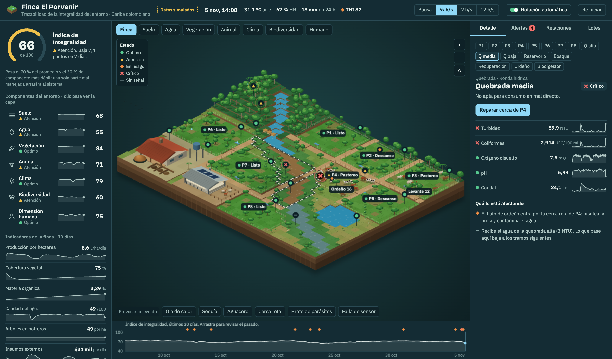
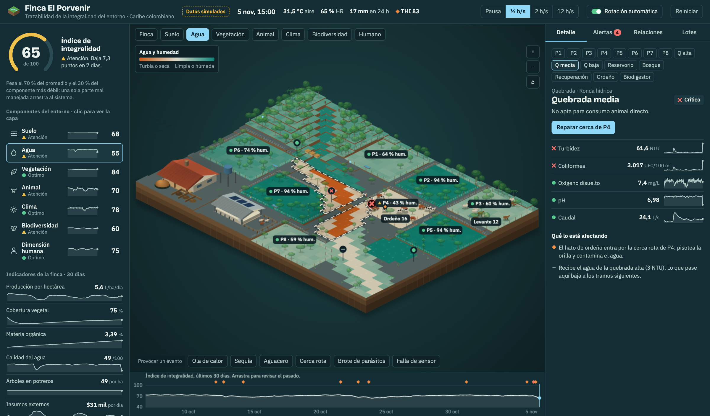
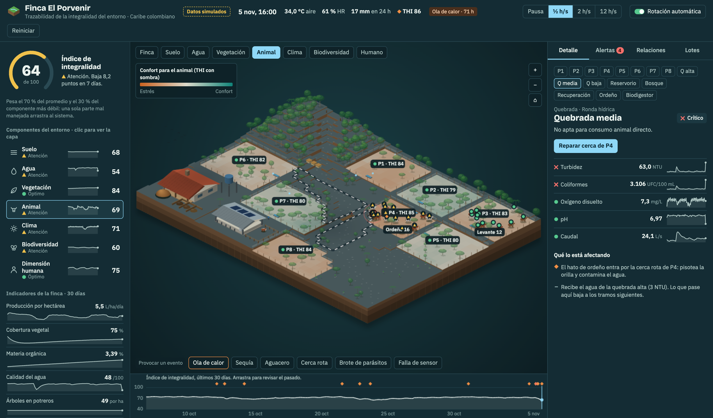
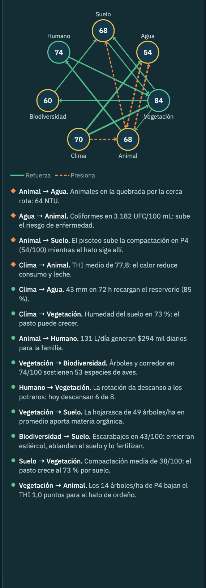
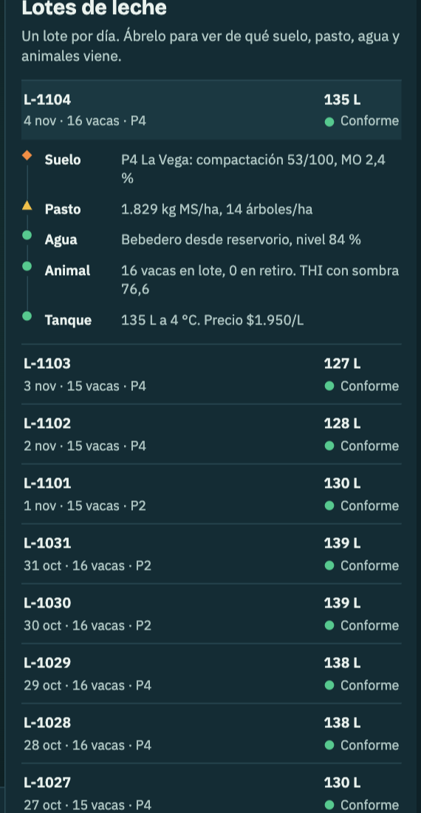
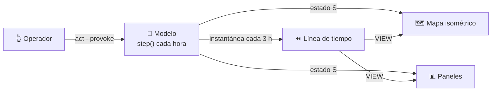

<div align="center">

# 🌳🐄💧 AgroTech Lab · Finca El Porvenir

### Un gemelo digital *experimental* para ver la finca ganadera como lo que es: **un solo sistema vivo**

**[▶ Abrir la demo en vivo](https://andybolano.github.io/agroTechLab/)**  ·  [Arquitectura](docs/ARQUITECTURA.md)  ·  [Trabajar con Claude](#-sigue-experimentando-con-claude)


[](https://github.com/andybolano/agroTechLab/actions/workflows/prueba-modelo.yml)

<a href="https://andybolano.github.io/agroTechLab/"></a>

<sub>Todo lo que ves se mueve: el ganado rota de potrero, llueve, anochece, los sensores reportan y la línea de tiempo guarda cada hora.</sub>

</div>

---

## 🧭 El problema

En una finca ganadera **todo está conectado**: el suelo compactado produce menos pasto, menos pasto obliga a sobrepastorear, el ganado sin sombra sufre calor y da menos leche, la vaca que bebe en la quebrada la contamina aguas abajo, y la familia que vive de esa leche paga las consecuencias.

Pero las herramientas que suelen usarse miran **una sola cosa a la vez**: un registro de producción, una app de clima, una planilla de vacunas. Nadie ve **la integralidad del entorno**.

**AgroTech Lab** es un experimento que hace la pregunta al revés:

> *¿Qué pasaría si pudiéramos ver la finca entera como un solo organismo, con cada relación visible, cada causa trazable y cada decisión con consecuencias medibles?*

## ✨ Qué hay en la demo

Una finca ficticia del Caribe colombiano, **Finca El Porvenir**, simulada hora a hora y monitoreada por 18 sensores virtuales.

| | |
|---|---|
| 🗺️ **Mapa isométrico vivo** | 8 potreros, quebrada en 3 tramos, reservorio, bosque, zona de recuperación, sala de ordeño, biodigestor y compost. 28 animales (Gyrolando, Brahman y las criollas Romosinuano y Costeño con Cuernos) que pastan, caminan y rotan. Lluvia, nubes, ciclo día/noche. |
| 🧩 **Los 7 componentes del entorno** | Suelo · Agua · Vegetación · Animal · Clima · Biodiversidad · Dimensión humana. Cada uno con su puntaje, su capa en el mapa y su historia. |
| 📊 **Índice de integralidad** | `70 % promedio + 30 % componente más débil`. Una parte mal manejada arrastra a todo el sistema, igual que en la realidad. |
| 🔗 **Relaciones en vivo** | Un grafo que se recalcula con los datos del momento: qué componente está reforzando o presionando a cuál, y por qué. |
| ⏪ **Trazabilidad total** | Arrastra la línea de tiempo y la finca entera vuelve a ese día. Bitácora con origen de cada evento (sensor, regla, operador, automático). |
| 🥛 **Del vaso al potrero** | Cada lote de leche se rastrea hasta el suelo, el pasto, el agua y los animales que lo produjeron. Las vacas en retiro quedan fuera. |
| ⚡ **Provoca eventos** | Ola de calor, sequía, aguacero, cerca rota, brote de parásitos, falla de sensor. Mira cómo se propaga el daño… y cómo se recupera. |

<table>
<tr>
<td width="50%"><br><sub><b>Capa Agua.</b> La cerca rota de P4 deja al hato en la quebrada: el tramo medio se pone crítico y la contaminación baja hacia el resto.</sub></td>
<td width="50%"><br><sub><b>Ola de calor + capa Animal.</b> Los potreros silvopastoriles (con árboles) bajan el estrés calórico del ganado. La sombra se ve en los datos.</sub></td>
</tr>
<tr>
<td><br><sub><b>Relaciones.</b> Cada flecha se calcula con datos del momento: refuerza (verde) o presiona (naranja).</sub></td>
<td><br><sub><b>Lotes de leche.</b> Cada lote abre su cadena: suelo → pasto → agua → animal → tanque.</sub></td>
</tr>
</table>

## 🚀 Pruébalo en 60 segundos

1. Abre la **[demo](https://andybolano.github.io/agroTechLab/)**. La finca arranca con 30 días de historia y **un problema activo**.
2. En el panel derecho verás la **Quebrada media en estado crítico**. Pulsa **Reparar cerca de P4** y sube la velocidad a `12 h/s`: mira cómo se limpia el agua aguas abajo.
3. Provoca una **Ola de calor** y activa la capa **Animal**: los potreros con árboles sufren menos.
4. Apaga la **Rotación automática** y espera: aparece el sobrepastoreo, el suelo se compacta y el índice cae.
5. **Arrastra la línea de tiempo** para volver al pasado y ver cuándo empezó todo.

## 💻 Córrelo en tu máquina

No hay nada que instalar. De verdad.

```bash
git clone https://github.com/andybolano/agroTechLab.git
cd agroTechLab
open index.html                 # o doble clic. En Linux: xdg-open index.html
```

¿Prefieres un servidor local? Solo necesitas Node 18+:

```bash
node tools/servir.mjs           # → http://localhost:8080
node tools/sim-test.mjs         # simula 300 días en ~1 s y valida el modelo
```

## 🏗️ Arquitectura en un vistazo

HTML + CSS + JavaScript puro, **sin dependencias y sin build**, separado en un **modelo** que no sabe dibujar y una **vista** que solo lee el estado.

```
agroTechLab/
├── index.html                  # estructura de la página
├── src/
│   ├── css/app.css             # tema visual (tokens en :root)
│   └── js/
│       ├── 01-util.js          # estados, colores, fechas        ┐
│       ├── 02-world.js         # rejilla, potreros, sensores     ├─ MODELO (corre en Node)
│       ├── 03-sim.js           # simulación hora a hora          ┘
│       ├── 04-layers.js        # capas del mapa                  ┐
│       ├── 05-render.js        # motor isométrico en Canvas 2D   │
│       ├── 06-panels.js        # paneles, fichas, relaciones     ├─ VISTA
│       ├── 07-timeline.js      # línea de tiempo / viaje al pasado
│       ├── 08-interaction.js   # mouse, zoom, teclado            │
│       └── 09-boot.js          # arranque                        ┘
├── tools/
│   ├── sim-test.mjs            # prueba del modelo sin navegador
│   ├── captura.mjs             # captura con Chrome headless
│   └── servir.mjs              # servidor estático mínimo
├── docs/ARQUITECTURA.md        # el detalle: estado, ciclo, recetas
├── CLAUDE.md                   # el "manual de la casa" para Claude
└── .claude/                    # comandos y agentes listos para usar
```



Lee **[docs/ARQUITECTURA.md](docs/ARQUITECTURA.md)** para la forma del estado, el ciclo de una hora y las recetas para extender la finca.

## 🤖 Sigue experimentando con Claude

Este repo está **preparado para trabajar con [Claude Code](https://claude.com/claude-code)**. Clónalo, abre una terminal en la carpeta y escribe `claude`. Claude leerá automáticamente [`CLAUDE.md`](CLAUDE.md), así que ya conoce los principios del proyecto, el mapa del código y cómo verificar sus cambios.

### Comandos incluidos

| Comando | Qué hace |
|---|---|
| `/experimento <hipótesis>` | Protocolo científico: línea base → cambio mínimo → comparación mes a mes → lectura sistémica → veredicto. |
| `/nuevo-evento <evento>` | Agrega un escenario a “Provocar un evento”, con su cadena de efectos y su registro en la bitácora. |
| `/nueva-capa <capa>` | Agrega una capa al mapa (p. ej. carbono, erosión) con su leyenda. |
| `/nuevo-sensor <sensor>` | Agrega un sensor simulado con ficha, estado y falla. |
| `/conectar-datos-reales <fuente>` | Planea un adaptador para reemplazar una variable simulada por datos reales, sin tocar la vista. |
| `/verificar` | Corre la prueba del modelo, toma una captura y la revisa antes de dar algo por terminado. |

Y un subagente, **`revisor-agronomico`**, que revisa tus cambios al modelo con criterio de ganadería tropical y te dice qué no es plausible.

### Ideas para tu primer experimento

```text
/experimento si cambio el índice a 50 % promedio + 50 % mínimo, ¿qué componente domina la historia del año?
/nuevo-evento llega un comprador que paga 15 % más por leche con trazabilidad completa
/nueva-capa carbono almacenado en suelo y árboles
/conectar-datos-reales temperatura y lluvia de Open-Meteo para Montería
```

```text
Haz que el reservorio no se vacíe en corridas largas: revisa el balance hídrico y muéstrame la tabla de sim-test antes y después.
Agrega cercas vivas entre potreros y mide su efecto sobre biodiversidad y THI.
Crea una vista "modo productor" en celular con solo 3 números y una acción recomendada.
```

## 🧪 Retos abiertos

- [ ] **Balance hídrico:** en corridas de 300 días el reservorio baja hasta ~14 % aun con lluvias. ¿Qué falta en el modelo?
- [ ] **Persistencia:** guardar la historia para no perderla al recargar.
- [ ] **Datos reales:** conectar clima real y dejar el resto simulado, marcando en la UI qué es qué.
- [ ] **Escenarios de política:** pago por servicios ambientales, sello de leche sostenible, crédito verde.
- [ ] **Multi-finca:** comparar dos fincas con manejo distinto lado a lado.
- [ ] **Móvil:** probar y pulir gestos táctiles (pellizcar para hacer zoom).

## ⚠️ Aviso honesto

Este es un **prototipo experimental**. **Todos los datos son simulados** y las fórmulas son aproximaciones plausibles escritas para explorar la idea, **no un modelo agronómico calibrado**. Sirve para pensar, enseñar y prototipar; **no** para tomar decisiones sobre una finca real.

## 🎓 Origen

Nació como resultado de un **laboratorio práctico del workshop de Claude** realizado el **jueves 5 de noviembre de 2026**. El punto de partida fue un texto sobre *la integralidad del entorno en la ganadería* y una pregunta: *¿cómo se vería una herramienta de trazabilidad que no mire una cosa a la vez?* Todo se construyó conversando con Claude Code: la simulación, el motor isométrico, los paneles y esta documentación.

Si estuviste en el workshop: **haz fork, rompe cosas y comparte lo que descubras.** 🌱

## 📄 Licencia

[MIT](LICENSE). Úsalo, modifícalo y compártelo.
