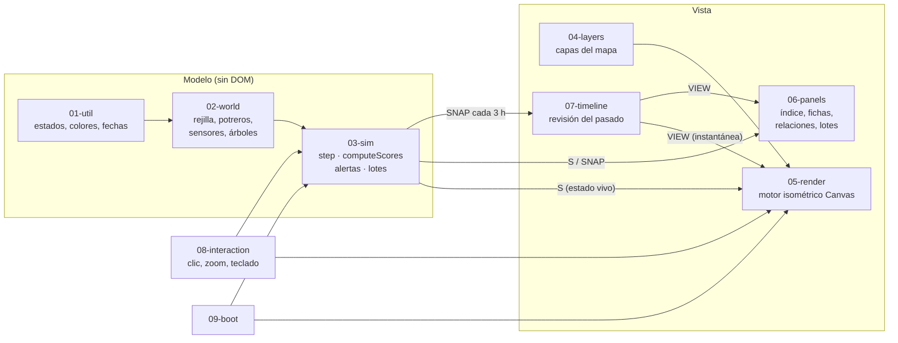

# Arquitectura

> Cómo está construida la Finca El Porvenir y cómo extenderla sin romperla. Pensada para leerla con Claude al lado.

## Vista general



**Regla de oro:** el modelo (`01`–`03`) no sabe cómo se dibuja. La vista lee el estado y lo pinta. Por eso `tools/sim-test.mjs` puede correr 300 días de finca en Node en ~1 segundo.

## Por qué scripts clásicos y no módulos ES

Los módulos ES (`import`) no funcionan al abrir el HTML con doble clic (`file://`). Queremos que cualquier asistente del workshop descargue el ZIP y lo abra sin instalar nada. Los scripts clásicos comparten el ámbito global léxico: un `const` declarado en `02-world.js` es visible en `05-render.js`. El costo es que **el orden de carga importa** y que los nombres globales no deben chocar.

## El ciclo de una hora simulada

`step()` en `03-sim.js` avanza el reloj una hora y, en este orden:

1. **Clima:** temperatura y humedad con ciclo diario y estacional, lluvia con probabilidad por mes, THI (índice temperatura-humedad), eventos activos (ola de calor, sequía, aguacero).
2. **Potreros:** humedad del suelo, crecimiento del pasto (lluvia, sombra, compactación), consumo del hato, compactación por pisoteo, materia orgánica, carga de parásitos, descanso.
3. **Agua:** balance del reservorio (lluvia − evaporación − consumo), caudal y calidad de los tres tramos de quebrada (Q1 → Q2 → Q3, lo que entra arriba baja). La cerca rota deja al ganado en la orilla: sube turbidez y coliformes.
4. **Biodiversidad:** aves, escarabajos estercoleros, polinizadores y corredor, en función de árboles y manejo.
5. **Animales:** estrés térmico con el efecto de la sombra (`shadeK`), rumia, temperatura, producción de leche, enfermedad y retiro.
6. **Economía e insumos:** ingresos, costos e insumos externos, margen de la familia.
7. **Rotación automática** (si está activa): mueve un grupo cuando el forraje baja de un umbral y elige el potrero mejor recuperado.
8. **Puntajes, alertas y lotes:** `computeScores`, `updateAlerts`, un lote de leche diario a las 18 h (`makeLot`) con su cadena de procedencia.
9. **Instantánea** del estado cada 3 h en `SNAP` (para la línea de tiempo).

## Forma del estado `S`

```js
S = {
  t,                        // horas desde el inicio (int)
  w: { temp, rh, rain, raining, wind, thi, thi24, cloud, rain24, rain72 },
  pad: { P1..P8: { bio, cov, moist, om, comp, para, trees, rest, occ, water, score } },
  q:   { Q1..Q3: { ntu, coli, ph, o2, flow } },          // tramos de quebrada
  res: { level },                                         // reservorio 0–100 %
  bio: { birds, beetles, poll, corridor, last },
  cow: [ { id, grp, breed, wt, temp, rum, milk, health, retiro, stress, … } ],
  grp: { G1: hato de ordeño, G2: levante } -> { pad, since, lock },
  fence: { broken, pad, seg, since, repairing },
  ev:  { heat, drought, storm },                          // horas restantes de cada escenario
  off: { [sensorId]: horaDeFalla },
  inp, hum,                                               // insumos y dimensión humana
  scores: { suelo, agua, veg, animal, clima, bio, humano }, // 0–100
  idx                                                     // índice de integralidad 0–100
}
```

Otras estructuras globales: `LOG` (bitácora, máx. 600), `LOTS` (lotes de leche, máx. 45), `ALERTS` (alertas activas por clave), `SNAP` (instantáneas, máx. 1200 = 150 días), `GRPLOG` (historial de potreros por grupo).

### El índice de integralidad

```
idx = 0,7 × promedio(7 componentes) + 0,3 × mínimo(7 componentes)
```

El 30 % del componente más débil es deliberado: una finca con suelo excelente y agua contaminada **no** es una finca sana. Cambiar esa ponderación es un buen primer experimento.

## Revisión del pasado (time travel)

`VIEW` es `null` en vivo o una instantánea de `SNAP`. Render y paneles leen `VIEW ?? S`. Al arrastrar la línea de tiempo se asigna `VIEW`; cualquier acción del operador vuelve a vivo con `goLive()`. Las instantáneas son copias JSON completas: simple y robusto, a cambio de memoria (~150 días).

## Render isométrico

- Proyección `iso(x, y, z)` en `02-world.js`: celdas de 32×16 px, 6 px por nivel.
- El terreno se pinta en un canvas fuera de pantalla (`terr`) y solo se repinta si `terrDirty`.
- Lo que se mueve (vacas, trabajadores, aves, lluvia, paquetes de datos, pines) se ordena por profundidad (`x + y`) y se dibuja encima en cada cuadro.
- Un árbol dibujado representa 10 árboles reales (`DRAWN = 10`) para no tapar el pasto.
- Cámara con zoom y paneo (`cam`), respetando el zoom del usuario al redimensionar.

## Recetas de extensión

### Agregar un escenario (“Provocar un evento”)
1. Botón en `index.html` dentro de `#scen`: `<button class="chip ev" data-ev="plaga">Plaga</button>`.
2. Rama en `provoke(e)` (`03-sim.js`) que cambie el estado y llame `addLog(...)`.
3. Si dura en el tiempo, agrégalo a `S.ev` y descuéntalo en `step()`.
4. Corre `node tools/sim-test.mjs` y prueba el botón.

Atajo: `/nuevo-evento`.

### Agregar una capa del mapa
1. Entrada en `LAYERS` (`04-layers.js`) con `k`, `n`, `leg`, `lo`, `hi`.
2. Caso en `layerVal(t, v)` que devuelva 0–100 para cada celda.
3. Si representa un componente nuevo, agrégalo también en `COMP` (`01-util.js`) y en `computeScores`.

Atajo: `/nueva-capa`.

### Agregar un sensor
1. `SENS.push({ id, kind, name, x, y, … })` en `02-world.js`.
2. Su lectura y estado en `sensorStatus` / `sensorScore` (`05-render.js`) y su ficha en `detailSensor` (`06-panels.js`).

Atajo: `/nuevo-sensor`.

### Conectar datos reales
El camino recomendado es reemplazar **una fuente a la vez** sin tocar la vista: un adaptador que, en cada `step()`, sobrescriba la variable simulada con la medición real (por ejemplo `S.w.temp` desde una API meteorológica) y marque su origen en la bitácora. Atajo: `/conectar-datos-reales`.

## Pruebas

| Herramienta | Qué valida |
|---|---|
| `node tools/sim-test.mjs [días]` | El modelo corre en Node; reparar la cerca baja la turbidez; ningún puntaje sale de 0–100 ni se vuelve `NaN`; el reloj avanza; se generan lotes. Imprime una tabla mensual para comparar antes/después. |
| `node tools/captura.mjs` | Que la página carga y se dibuja (revisa la imagen). |
| Gancho `window.__finca` | Desde la consola del navegador: `__finca.S`, `__finca.step()`, `__finca.act('fence','P4')`, `__finca.provoke('heat')`. |

## Limitaciones conocidas (buenos retos)

- **El reservorio se vacía en corridas largas:** en 300 días baja de ~83 % a ~14 % incluso tras las lluvias. El balance hídrico necesita revisión.
- **Fórmulas ilustrativas:** crecimiento de pasto, THI → leche, parásitos y biodiversidad son aproximaciones plausibles, no calibradas.
- **Sin persistencia:** al recargar, la finca vuelve a empezar.
- **Gestos táctiles** (pellizcar para hacer zoom) no se han probado en dispositivos reales.
